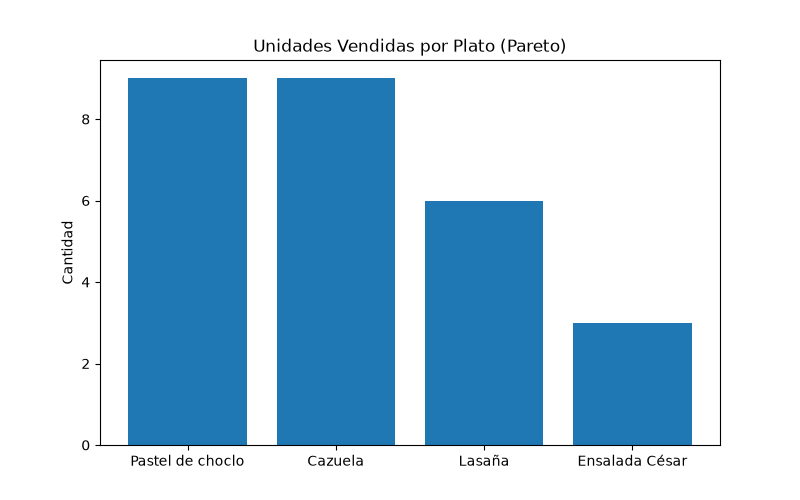
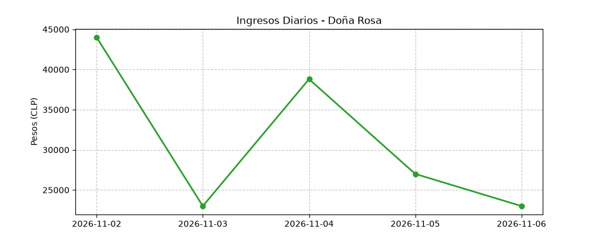

# Sistema ETL - Cocina Doña Rosa
Repositorio para la prueba técnica de Avostech.

## Instalación y Ejecución

El proyecto utiliza Python estándar sin dependencias externas pesadas para el pipeline. 

### Ejecutar el reporte
El ETL utiliza una arquitectura `data/raw/` para insumos y `data/processed/` para salidas. Para ejecutarlo:

```bash
python src/main.py data/raw/pedidos.csv data/raw/catalogo.csv data/processed/reporte.json
```
### Correr los Tests (TDD)
Se implementó `pytest` para validar las reglas de negocio aisladas.
```bash
python -m pytest tests/
```


## Parte 1 - Análisis del problema

### 1. Problemas de fondo vs. Síntomas
Para diagnosticar el estado del negocio, es necesario separar el dolor diario de Rosa (síntomas) de las fallas en sus procesos (problemas de fondo).

**Síntomas (Las consecuencias visibles):**
*   **Pérdida de información:** Se le pierden pedidos, especialmente en WhatsApp.
*   **Mermas y quiebres de stock:** Unos días sobra comida que debe botar, y otros días se queda corta.
*   **Incertidumbre financiera:** A fin de mes no sabe con exactitud cuánto le debe cada empresa.
*   **Barrera psicológica:** Siente vergüenza al cobrar, derivada de la inseguridad en sus registros.
*   **Ineficiencia logística:** El repartidor pierde mucho tiempo en la ruta.

**Problemas de Fondo (La causa raíz operativa):**
*   **Ingesta de datos multicanal desestructurada:** Los pedidos entran por tres vías informales (WhatsApp, Instagram, teléfono) y sufren un doble registro manual asíncrono (cuaderno y luego planilla). Esto rompe la trazabilidad.
*   **Producción a ciegas (Falta de forecasting):** Cocina un lote estático de 80 a 120 almuerzos sin basarse en demanda histórica ni establecer un horario de corte para confirmar pedidos. 
*   **Ausencia de conciliación y control de crédito B2B:** Las empresas acumulan deuda sin un sistema transaccional auditable que valide el consumo diario. 
*   **Ausencia de enrutamiento:** No hay consolidación de despachos por zona.

### 2. Preguntas antes de proponer una solución y supuestos


1. **Pregunta (Ingesta por WhatsApp):** Ya que los pedidos por WhatsApp son los que más se te pierden, ¿cómo es tu proceso de captura en ese canal? (Ej. ¿Anotas en el cuaderno de inmediato o dejas los mensajes acumulados?).
   * **Por qué:** Entender por qué este canal en específico rompe la trazabilidad es vital. Si el canal es desestructurado, la información se evapora antes de llegar a la contabilidad.
   * **Supuesto:** Asumiré que WhatsApp es la principal fuente de datos sucios o incompletos. Por ello, el script aplicará validaciones estrictas (Reglas R1 a R8) y no confiará ciegamente en los datos crudos.

2. **Pregunta (Merma de comida fresca):** Considerando que cocinas todo fresco (lo que explica que debas botar lo que sobra), ¿a qué hora es tu corte estricto para recibir pedidos y poder calcular las porciones exactas sin que falte ni sobre?
   * **Por qué:** Cocinar de forma reactiva sin un límite horario hace imposible modelar la demanda, generando pérdida directa de inventario (merma) o quiebres de stock.
   * **Supuesto:** Asumo que actualmente no existe una hora de corte. Para este desarrollo inicial, el sistema procesará todo el CSV asumiendo que la cocina logró despachar cada fila anotada.

3. **Pregunta (Trazabilidad y Contabilidad):** Al no tener una contabilidad centralizada, ¿cómo validas al pasar los datos del cuaderno a la planilla que no le estás cargando un plato a la empresa equivocada?
   * **Por qué:** La pérdida de trazabilidad en la transcripción manual es la causa de su "vergüenza a cobrar". Si no hay cuadratura, el cobro B2B a fin de mes no tiene respaldo.
   * **Supuesto:** Asumo que el archivo `pedidos.csv` arrastra errores humanos. El sistema detectará automáticamente anomalías (ej. cobros inconsistentes) para que recuperes la confianza en tus números.

4. **Pregunta (Cuello de botella en Última Milla):** ¿El repartidor pierde tiempo porque los platos salen tarde de la cocina, o porque sale a despachar sin una ruta clara ni agrupación por edificios?
   * **Por qué:** Si la comida sale a destiempo y no hay orden en la última milla, el repartidor hace viajes ineficientes, destruyendo el nivel de servicio y haciendo que la comida llegue fría.
   * **Supuesto:** Asumo que los despachos actuales carecen de orquestación logística. El JSON resultante (`deuda_por_empresa`) servirá como estructura base para agrupar logísticamente los pedidos por nodo corporativo en el futuro.

5. **Pregunta (Validación de Crédito B2B):** Asumiendo que operas de forma formal con las empresas que te pagan a 30 días, ¿cómo validas que la persona que te escribe por WhatsApp realmente está autorizada para endeudar a esa oficina?
   * **Por qué:** Dar crédito exige auditar quién lo usa. Si cualquier persona pide a nombre de una empresa, hay un riesgo de fraude o desconocimiento de deuda a fin de mes.
   * **Supuesto:** Asumiré que estás al día con las normas sanitarias/tributarias para operar B2B, y que el dato ingresado en la columna `empresa` ya fue validado por ti, representando una deuda incuestionable.

### 3. Análisis de la sugerencia del sobrino ("Necesitas una app")

La sugerencia de crear una "app" fracasa porque asume un enfoque transaccional (B2C) para un problema que es estrictamente de procesos internos, capacidad de planta y centralización B2B. La sugerencia es errónea por tres motivos fundamentales:

1. **Fricción de adopción y error de público objetivo:**
   Pedirle a oficinistas que descarguen una app para pedir el almuerzo genera un filtro comercial altísimo. El cliente B2B busca inmediatez (WhatsApp). Si existiera un software, no debería ser una app para los clientes, sino un sistema interno (backend) operado por Rosa para centralizar los canales y generar comprobantes de trazabilidad, no un "carrito de compras".

2. **Desconexión con el flujo de producción (El límite físico):**
   El sobrino cree que Rosa necesita una mejor interfaz para anotar pedidos. La realidad operativa es que Rosa **no debería estar anotando pedidos mientras cocina**. Ella necesita contabilizar los platos *antes* de encender los quemadores. Además, la tecnología no soluciona el límite de capacidad instalada (ej. si Rosa trabaja sola o tiene equipo); el sistema debe adaptarse a su rendimiento máximo, no al revés.

3. **Digitalizar el desorden destruye la calidad:**
   Una aplicación no soluciona la merma diaria de alimentos ni las demoras logísticas en la última milla si el negocio sigue recibiendo pedidos sin un horario de corte estricto. Implementar software sobre un proceso sin reglas solo digitaliza el caos, somete a la cocina a estrés reactivo y termina mermando la calidad del producto final.

**Propuesta para las primeras 2 semanas (MVP de bajo costo y baja fricción tecnológica):**
Considerando que Rosa tiene presupuesto limitado y nula experiencia tecnológica, el entregable de las primeras dos semanas no será un nuevo software que deba aprender a usar, sino una **estructura de trazabilidad operativa** apoyada en herramientas gratuitas que ella ya conoce. El plan se divide en tres entregables:

1. **Trazabilidad de Ingesta (Orden en el canal principal):** 
   Migración de su WhatsApp personal a WhatsApp Business (costo $0). Se configurarán respuestas automáticas y un mensaje de bienvenida que exija un formato estricto al oficinista (Ej: "Nombre, Empresa, Plato, Cantidad"). Esto elimina el ruido de los audios y estructura el dato desde el origen.

2. **Trazabilidad de Producción (Control de Merma):** 
   Establecimiento de un "Acuerdo de Nivel de Servicio" (SLA) con sus clientes: una **hora de corte estricta** (ej. 11:00 AM). Pasada esa hora, no se reciben pedidos. Esto le permitirá contabilizar el total exacto antes de encender los quemadores, eliminando la sobreproducción (merma) y asegurando que la comida salga a tiempo para el ruteo del repartidor.

3. **Trazabilidad Financiera (El script ETL):** 
   Entrega del programa CLI desarrollado en esta prueba. Rosa seguirá usando su cuaderno y su planilla habitual sin fricción. Al final del día, el script procesará la planilla, filtrará los errores humanos de digitación y le entregará un reporte limpio y automatizado de la deuda B2B, eliminando su inseguridad al cobrar.


## Parte 4 - Preguntas de Diseño

### 1. Proyección de Demanda (Forecasting del Lunes)
Para calcular cuántos almuerzos preparar el próximo lunes, utilizaría un modelo de series de tiempo simple (como medias móviles) basado en el comportamiento histórico específico de los días lunes, ya que la demanda en rubros alimenticios tiene alta estacionalidad intra-semanal. 
**Datos faltantes:** 
Actualmente solo tenemos una semana de muestra (2 al 6 de noviembre). Para una proyección estadísticamente válida necesito:
- Historial de al menos 4 a 8 semanas hacia atrás para calcular promedios fiables.
- Tasa histórica de "No Show" o cancelaciones de último minuto.
- Variables exógenas simples (ej. estado del clima).

### 2. Análisis del Negocio (Insights de los Datos)
Para responder esta pregunta, desarrollé el script adicional `src/analisis.py` que consume el JSON y genera gráficos analíticos. Los hallazgos principales son:

- **Ley de Pareto en el Menú:** El Pastel de choclo y la Cazuela sostienen el negocio. La Ensalada César tiene una rotación bajísima (3 unidades). Sugiero eliminarla del catálogo para simplificar la logística y reducir la merma de vegetales frescos.



- **Concentración de Riesgo B2B y Volatilidad:** El JSON arroja $91.000 pesos en deuda no saldada en una sola semana. Rosa está operando como prestamista a tasa cero para corporaciones, asumiendo un riesgo de liquidez crítico. Además, los ingresos diarios muestran una alta volatilidad, lo que dificulta la planificación de compras.



### 3. Impacto Arquitectónico de un Formulario Web
Si Rosa cambia WhatsApp por un formulario web (Typeform, Google Forms, App interna), el impacto en nuestro programa demuestra los beneficios de haber aislado la lógica:
- **Lo que CAMBIA (Capa de Extracción):** La función `procesar_pedidos` y la dependencia de `csv.DictReader`. En lugar de leer un archivo plano ruidoso, consumiríamos un JSON estructurado desde una API o base de datos.
- **Lo que NO CAMBIA (Capa de Transformación y Carga):** El motor de reglas (`src/rules.py`) se mantiene intacto. Las validaciones de fechas hábiles, cantidades mínimas, el catálogo de precios y la lógica de agrupación en memoria para el descuento corporativo seguirían funcionando exactamente igual, demostrando una arquitectura desacoplada y escalable.

### 4. Escala de los Datos vs. Realidad Operativa
Noté una discrepancia evidente: el caso indica que la capacidad de planta de Rosa es de 80 a 120 almuerzos diarios, pero el archivo `pedidos.csv` refleja apenas 27 unidades válidas en toda la semana. Abordé este CSV como un *toy dataset* diseñado exclusivamente para probar la lógica de las reglas R1-R9 y forzar los casos borde. No obstante, la arquitectura del ETL (lectura secuencial y agrupación temporal en memoria) está diseñada para soportar el caudal real de 120+ platos diarios sin degradación de rendimiento.